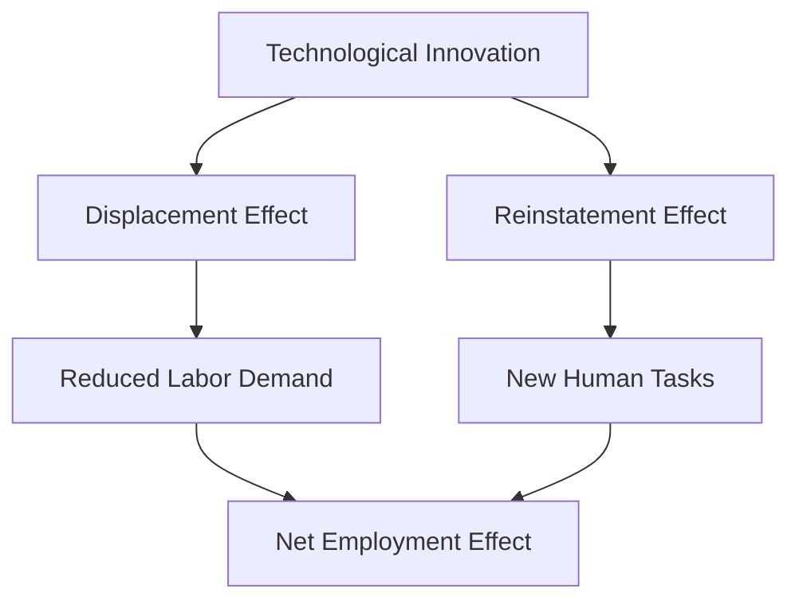
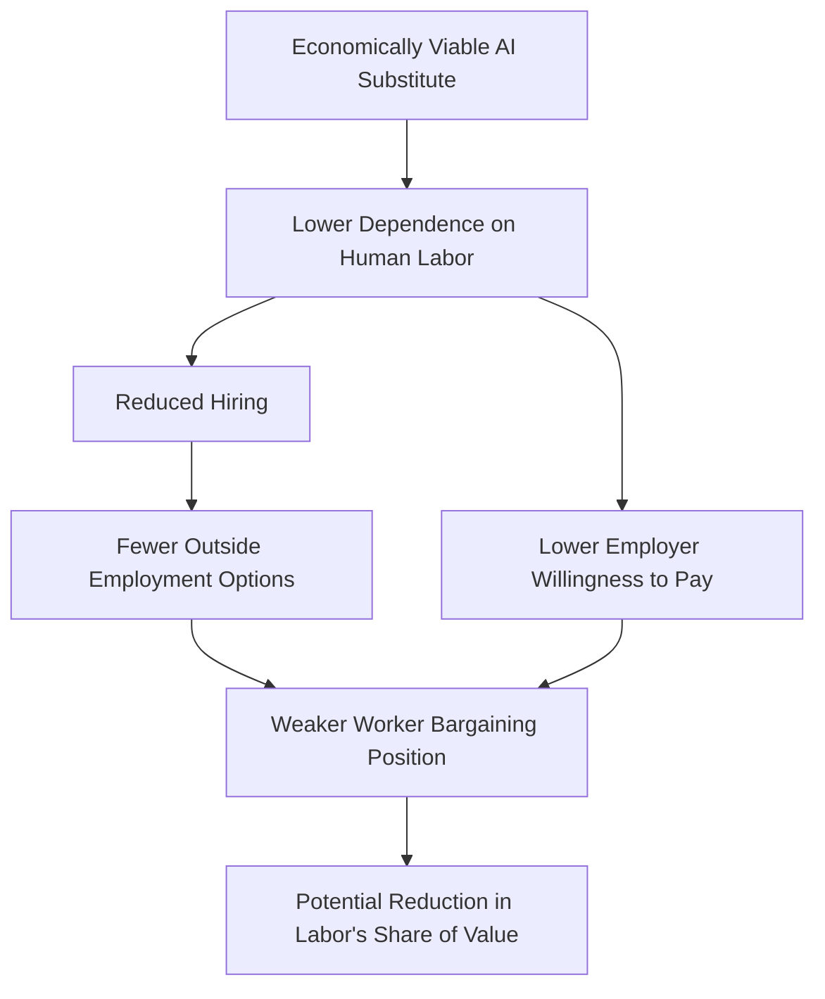

*Technology & Political Economy*

## Introduction: The Changing Economics of Human Labor

Artificial intelligence changes the relationship between capital and labor by introducing an increasingly capable alternative to human cognitive work. Businesses have historically depended on workers for specialized knowledge, judgment, and expertise, giving labor bargaining power through the scarcity of those capabilities.

Large language models (LLMs) allow firms to purchase computational capabilities that substitute for portions of specialized work. Employers with economically viable alternatives to human labor may gain negotiating leverage without reducing their existing workforce.

This article examines how AI-driven substitution affects labor demand, bargaining power, and the distribution of productivity gains, using historical evidence and a simplified economic model.

## 1. Automation and the Historical Relationship Between Capital and Labor

Technological development has repeatedly enabled capital to substitute for human labor.

| Innovation | Primary labor substitution |
| --- | --- |
| Industrial Revolution | Manual production and physical labor |
| Electrification | Mechanical power and industrial operations |
| Industrial robotics | Repetitive physical tasks |
| Computers and software | Routine information processing |
| Generative AI | Cognitive tasks across multiple occupations |

Economists Daron Acemoglu and Pascual Restrepo identify two mechanisms in [*Automation and New Tasks* (2019)](https://www.nber.org/papers/w25684):

1. **Displacement effect:** Technology takes over tasks previously performed by workers, reducing labor demand.
2. **Reinstatement effect:** Technology creates new tasks in which humans retain comparative advantages.

Agricultural mechanization reduced farm employment while industrialization expanded manufacturing. Computerization eliminated routine clerical tasks while generating demand for software engineers and technical administrators. These transitions redistributed employment across occupations, but displaced workers often lacked the skills, mobility, or opportunities necessary to benefit from emerging industries.

Aggregate employment growth can therefore coexist with persistent economic losses among workers exposed to automation.

## 2. What Makes Artificial Intelligence Different?

AI operates through established economic mechanisms, but several characteristics may amplify their effects:

1. **General-purpose cognitive substitution.** A single model can perform tasks across software engineering, research, administration, and customer support, reducing the need for specialized automation systems.

2. **Rapid diffusion.** AI capabilities can be distributed through existing software infrastructure. Enterprise integration, verification, and governance constrain deployment, but software distribution substantially reduces the physical requirements associated with earlier industrial automation.

3. **Automation of complementary technical work.** Previous innovations created demand for workers developing and maintaining new technologies. AI can already perform portions of programming, testing, documentation, and system administration, potentially reducing the scarcity premiums associated with newly acquired technical skills.

The third characteristic complicates occupational adjustment. If technological progress automates portions of the work created by previous innovations, the economic lifespan of certain specialized skills may shorten. Human judgment, organizational knowledge, and accountability remain necessary, but preserving these functions does not necessarily preserve existing staffing requirements.

## 3. Productivity, Labor Substitution, and Bargaining Power

An employee's productivity and bargaining power are distinct economic properties. A worker can maintain their productive contribution while experiencing declining compensation leverage if employers acquire cheaper alternatives.

### A simplified economic model

Consider a firm choosing between employing a specialist and deploying an AI system.

| Variable | Definition |
| --- | --- |
| $V_H$ | Annual economic value generated by the human worker, before wages |
| $V_{AI}$ | Annual economic value generated by the AI alternative, before operating costs |
| $K_{AI}$ | Annual AI costs, including infrastructure, integration, and supervision |
| $b$ | Worker's outside employment option |
| $\beta$ | Worker's bargaining share, between 0 and 1 |

Assuming the firm can choose human labor, an AI alternative, or neither, its maximum economically justified wage is:

$$
W_{\max} = V_H - \max(0, V_{AI} - K_{AI})
$$

A simplified bargaining equation is:

$$
W = b + \beta(W_{\max} - b)
$$

This assumes the worker's outside option is below the employer's maximum willingness to pay. The equation represents a negotiated division of surplus rather than a general model of wage determination.

### Numerical example

Suppose a specialist generates \$180,000 in annual economic value, has an outside employment option worth \$100,000, and captures half the available bargaining surplus.

Without an AI substitute, the negotiated wage is:

$$
W = 100{,}000 + 0.5(180{,}000 - 100{,}000) = 140{,}000
$$

An AI system producing equivalent output at an annual cost of \$125,000 reduces the employer's maximum willingness to pay for human labor to \$125,000.

$$
W = 100{,}000 + 0.5(125{,}000 - 100{,}000) = 112{,}500
$$

| Measure | No AI alternative | Equivalent AI alternative |
| --- | ---: | ---: |
| Human-generated value | \$180,000 | \$180,000 |
| Employer's maximum wage | \$180,000 | \$125,000 |
| Worker outside option | \$100,000 | \$100,000 |
| Negotiated wage | \$140,000 | \$112,500 |

*Hypothetical figures assuming equivalent output, unchanged outside options, and unchanged bargaining parameters.*

The worker's productive contribution remains unchanged, but the employer's economically viable alternative lowers the negotiated wage. Widespread substitution could further reduce compensation by weakening workers' outside employment options.

### Labor-market effects

Two mechanisms reinforce one another:

1. **Employer substitution:** Cheaper productive alternatives reduce the maximum wage an employer can economically justify.
2. **Labor-market contraction:** Reduced hiring weakens outside employment options, placing additional pressure on negotiated compensation.

The model also accommodates complementarity. If AI increases the value generated by a worker, $V_H$ may rise sufficiently to offset the improved automation alternative. The resulting wage effect depends on the relative changes in human productivity, substitution costs, and outside employment opportunities.

### Emerging evidence

A [Stanford Digital Economy Lab study revised in August 2026](https://digitaleconomy.stanford.edu/news/canariesaug26/) found that employment among workers aged 22–25 in highly AI-exposed occupations was approximately 19% below the level implied by trends among less-exposed peers. The adjustment occurred primarily through reduced hiring rather than layoffs.

These are descriptive patterns, not causal estimates: the study did not establish AI as the sole cause or identify widespread economy-wide displacement. Nevertheless, reduced entry-level hiring can have persistent consequences by limiting the opportunities through which junior workers acquire the practical experience required for senior positions.

## 4. Conditions That Could Offset Labor Displacement

The net employment effect depends on productivity gains, complementary human capabilities, demand expansion, and the creation of new economic activities.

A study by Brynjolfsson, Li, and Raymond, [*Generative AI at Work* (2025)](https://doi.org/10.1093/qje/qjae044), found that AI assistance increased customer-support productivity, measured by issues resolved per hour, by approximately 15% on average, with particularly large improvements among less-experienced workers.

Three mechanisms can offset displacement:

1. **Complementarity:** AI increases workers' productive contribution and their value to employers.
2. **Demand expansion:** Lower production costs increase consumption and total output, potentially supporting additional employment.
3. **New economic activities:** Reduced production costs make previously uneconomical businesses and occupations commercially viable.

The magnitude of demand expansion is particularly consequential. Assuming AI doubles output per worker while working hours remain unchanged:

| Total output change | Approximate labor demand change |
| --- | ---: |
| No growth | −50% |
| +50% | −25% |
| +100% | Unchanged |
| +200% | +50% |

*Illustrative calculations assuming proportional labor requirements and constant productivity per worker after adoption.*

Industries with substantial unmet demand may expand production enough to preserve or increase employment. Industries with limited additional demand face stronger substitution pressure. Complementarity may also increase wages for workers whose remaining tasks become more valuable or difficult to automate.

The effects will consequently differ across occupations according to task composition, demand responsiveness, and the availability of economically viable automation alternatives.

## 5. Measuring the Transfer of Economic Power

AI's distributional effects require examining compensation and labor-market conditions alongside employment.

| Indicator | Economic significance |
| --- | --- |
| Labor compensation as a share of value added | Distribution of production income between labor and other factors |
| Employment growth relative to productivity | Potential substitution of labor by capital |
| Entry-level hiring | Access to professional development pathways |
| Wage growth relative to productivity | Distribution of productivity gains |
| Job openings and worker mobility | Strength of outside employment alternatives |
| Business formation and self-employment income | Opportunities for independent economic production |

These indicators should be evaluated across industries with different levels of AI exposure, controlling for broader economic conditions and changes unrelated to AI.

The strongest evidence for a transfer of bargaining power would combine rising productivity with declining labor demand, weaker outside employment options, and a reduced labor share of value added in AI-exposed industries. Establishing causation would require distinguishing AI substitution from other drivers of wages, employment, and profitability.

## Conclusion

AI expands the range of human capabilities that capital can economically substitute. Where automation alternatives become cheaper and labor demand weakens, employers gain bargaining power even without widespread layoffs.

The long-term distributional outcome depends on whether complementary human productivity, new tasks, and demand expansion offset substitution. If they do not, productivity growth can become increasingly disconnected from labor compensation.

## Related Posts

- [What Is Your Moat?](./2026-10-15-what-is-your-moat.md) — How cheaper access to AI changes software replication costs, competitive advantage, and the assets businesses need to defend their returns.

## References and Further Reading

1. Acemoglu, D., & Restrepo, P. (2019). [Automation and New Tasks: How Technology Displaces and Reinstates Labor.](https://www.nber.org/papers/w25684) *Journal of Economic Perspectives, 33*(2), 3–30. [Published article](https://doi.org/10.1257/jep.33.2.3).

2. Brynjolfsson, E., Li, D., & Raymond, L. (2025). [Generative AI at Work.](https://doi.org/10.1093/qje/qjae044) *The Quarterly Journal of Economics, 140*(2), 889–942. [Open author manuscript](https://arxiv.org/abs/2304.11771).

3. Brynjolfsson, E., Chandar, B., & Chen, R. (2026). [Canaries in the Coal Mine? Six Facts about the Recent Employment Effects of Artificial Intelligence.](https://digitaleconomy.stanford.edu/news/canariesaug26/) Stanford Digital Economy Lab, revised August 12, 2026.

4. Acemoglu, D., & Restrepo, P. (2018). [Artificial Intelligence, Automation and Work.](https://www.nber.org/papers/w24196) NBER Working Paper 24196.

*Research note: This article evaluates an economic hypothesis rather than presenting a forecast. The bargaining model is illustrative and omits several institutional and labor-market factors.*

## Future Topics

1. **Determinism and Accountability in AI Systems** — How probabilistic AI behavior complicates validation, auditability, incident response, and accountability for human operators. Can operators reasonably be held responsible for decisions they cannot independently predict or verify?

2. **Hypothetical Scenario: What Happens When Most Cognitive Tasks Are Automated?** — Examine an economy in which cognitive labor ceases to be a scarce production input, including effects on wages, purchasing power, ownership, and the relationship between employment and income.

3. **Hypothetical Scenario: Could Self-Replicating and Self-Improving Small AI Models Become an Unkillable Worm?** — Explore a theoretical autonomous AI system capable of replication, adaptation, and distributed persistence, focusing on containment limits, infrastructure security, and control.
